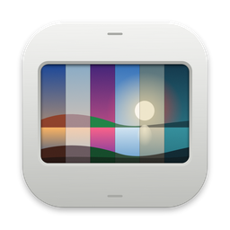
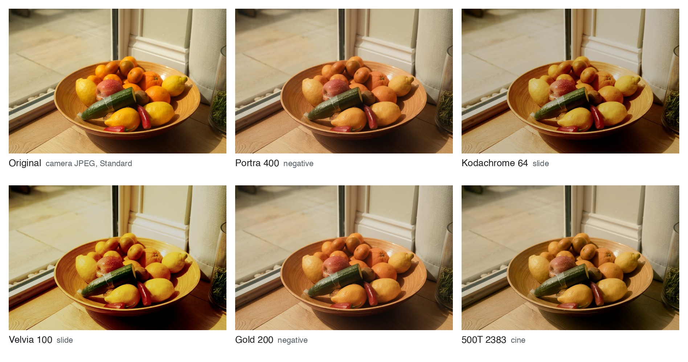
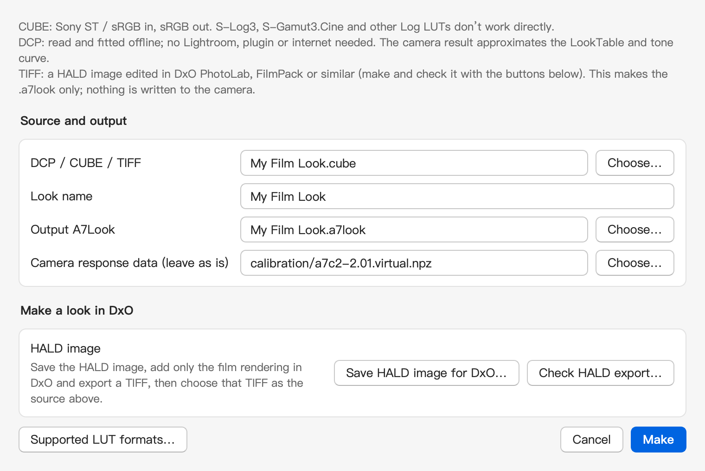
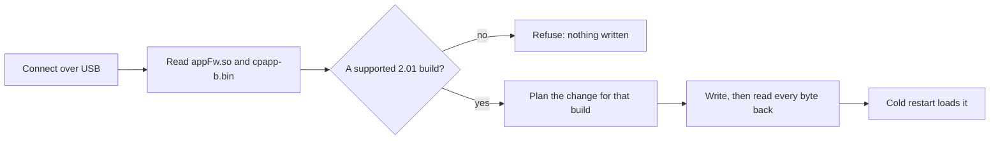

<a id="readme-top"></a>

<div align="center">
  

  <h1>A7C II Tools</h1>

  <p><b>Any LUT, in camera.</b></p>

  <p>
    <a href="#bring-your-own-look">Bring your own look</a> •
    <a href="#install">Install</a> •
    <a href="#first-run">First run</a> •
    <a href="#what-this-fork-changes">What this fork changes</a> •
    <a href="README.zh-CN.md">简体中文</a>
  </p>
</div>

<div align="center">

[![Latest release][release-shield]][release-url] [![License: PolyForm Noncommercial][license-shield]][license-url] [![Camera: ILCE-7CM2 firmware 2.01][camera-shield]][camera-url] [![macOS: Intel][macos-shield]][install-url]

</div>

Turn your LUTs, DCP profiles and editor looks into in-camera Creative Looks on the Sony A7C II. English fork, Intel Macs.

A7C II Tools converts a photo LUT, an Adobe DCP profile or the colour of a look from your editor into a Creative Look, and writes it into one of the camera's six Custom slots. Live view shows the look before you press the shutter, and every JPEG comes out with it. The same app adds FL2/FL3, vertical display and a shutter sound, and puts everything back on request.

This is a fork of [A7C II Tools](https://github.com/QAQLeonard/a7c2-fl23-research) by QAQLeonard. It adds an English interface, Intel Mac support, and a check of the camera's 2.01 firmware build before every write. Like upstream, it's free for noncommercial use only: nobody may sell it or charge to install it.

<picture>
  <source media="(prefers-color-scheme: dark)" srcset="docs/images/readme/looks-dark.jpg">
  
</picture>

<sub>Five open film LUTs converted by the app, on one camera JPEG (shot in Standard on an A7 IV), as the A7C II renders each from a Custom slot. Looks: [spektrafilm](https://github.com/andreavolpato/spektrafilm) by Andrea Volpato, CC BY-SA 4.0.</sub>

## Bring your own look

A look that changes only colour and tone can go into a Custom slot. The converter runs on your computer and takes three kinds of source:

| You have | How it goes in |
| --- | --- |
| A photo LUT (`.cube`) that takes Sony ST / sRGB and gives sRGB | Choose it as the source. |
| An Adobe camera profile (`.dcp`) | Choose it as the source. Lightroom isn't needed. |
| A look in an editor, such as a Lightroom or Capture One preset, DxO FilmPack or Dehancer | Save the converter's HALD image, apply the look's colour to it in your editor, export a 16-bit sRGB TIFF, and choose that TIFF. Tested with DxO FilmPack and Dehancer. |
| A video or Log LUT, such as S-Log3 to Rec.709 | First export an sRGB-in, sRGB-out version from your grading software; see [LUT formats](docs/en/lut-formats.md). |

1. On the **Custom looks** page, under **Tools**, click **Make…** next to **Make an A7Look**. Choose the source, give it a name and click **Make**. The converter fits the camera's look tables to your source 12 times and keeps the closest fit, so expect it to take a while.
2. Click **Add change**, pick a slot, set it to **Write A7Look** and choose your `.a7look`. **Preview…** puts your look on one of your own JPEGs shot in ST, as the source renders it and as the camera will, side by side. Nothing is written yet.
3. Click **Write 1 change…** and follow the dialogs. After the cold restart, the slot shows your look; the other slots stay as they are.

<picture>
  <source media="(prefers-color-scheme: dark)" srcset="docs/images/readme/convert-dark.png">
  
</picture>

> [!NOTE]
> The camera holds a fitted approximation of your look. If the fit is poor or unknown, the app names the look and asks before writing it. Grain, vignetting, sharpening and local adjustments can't live in a colour table, so they stay behind; the HALD check refuses an export that carries them.

## What it does

- **Your looks as Creative Looks.** CUBE LUTs, DCP profiles and editor looks become `.a7look` files for Custom 1–6, under the names you choose.
- **Preview before you write.** See your look as the source renders it and as the camera will, side by side on your own photo, before anything touches the camera.
- **Looks to start from.** 6 built-in looks, 12 open film looks, and 15 paired DCP profiles for Lightroom.
- **FL2 and FL3 in the Creative Look list.** Adds both looks to the camera's own menu; remove them again from the same page.
- **Vertical display.** Shooting info and icons turn when you hold the camera upright.
- **Electronic shutter sound.** Sony's own sound, or a clip of up to 2 seconds from any audio or video file.
- **Firmware-build check before every write.** The app identifies the camera's two program files, writes only to a build it knows, and reads the written files back in full afterwards.
- **Factory restore.** Puts Sony's original bytes back wherever the tool changed them. No backup or firmware download needed.

## How it fits your shooting

Say you edit with three LUTs you like: a warm portrait look, a faded street look and a slide-film look. You convert each on your Mac, preview them on a few of yesterday's JPEGs, and write all three into Custom 4, 5 and 6 in one run.

The app writes the three names first and asks for a cold restart, then writes the looks themselves and reads them back. After the second cold restart, Custom 4–6 hold your looks.

Now you switch between them on the camera and live view changes with each one, so you choose the look before you shoot. Every JPEG comes out graded, and raw files stay untouched, so you can still develop them your own way.

## Install

You need a Sony A7C II (ILCE-7CM2) on firmware 2.01, an Intel Mac (tested on macOS 15) and a USB cable that carries data.

> [!WARNING]
> This is unofficial research software, not made or endorsed by Sony. Writing to the camera can stop it booting, make it restart over and over or lose images and settings, and can affect official updates, warranty and repair. A complete read-back doesn't prove the camera will boot, and Factory restore may not recover it. Use it only on a camera you own or have the owner's permission to change, back up your images first, and read the full [risk notice](docs/en/notices.md#risk-notice-and-use-statement).

1. Download [`A7C2Tools-macOS-x86_64.dmg`](https://github.com/mplind/a7c2-fl23-research/releases/latest/download/A7C2Tools-macOS-x86_64.dmg) from the [latest release](https://github.com/mplind/a7c2-fl23-research/releases/latest).
2. Open it and drag **A7C II Tools** to Applications.
3. The app has no Developer ID signature. On first launch, allow it under **System Settings → Privacy & Security → Open Anyway**.

### Windows and Apple Silicon

This fork has been built and tested only on an Intel Mac, because that is the only computer I have. The code is the same on every platform, so you can build it on the computer you want to run it on.

1. Install 64-bit Python 3.11, then get the code and the build tools:

    ```sh
    git clone https://github.com/mplind/a7c2-fl23-research.git
    cd a7c2-fl23-research
    python -m pip install --no-build-isolation -r desktop-requirements.txt pyinstaller==6.16.0
    ```

2. Download [`A7C2Tools-desktop-assets.zip`](https://github.com/mplind/a7c2-fl23-research/releases/latest/download/A7C2Tools-desktop-assets.zip) from the [latest release](https://github.com/mplind/a7c2-fl23-research/releases/latest) and unzip it in that folder. It holds the six built-in looks, the film-look library, the paired DCP profiles and the shutter sounds, the same files the macOS package carries.
3. Add your platform's helpers and build:

    ```sh
    python dev/desktop/prepare_assets.py
    python dev/desktop/build.py --edition public
    ```

4. The package lands in `dist/`: `A7C2Tools-Windows-x64.zip` on Windows, `A7C2Tools-macOS-arm64.dmg` on an Apple Silicon Mac. On Windows, the **Connection and drivers** page also sets up the camera's USB drivers.

> [!TIP]
> If you build it on Windows or Apple Silicon, open a [build report](https://github.com/mplind/a7c2-fl23-research/issues/new?template=build-report.yml) with your package, your operating system and what you tried on the camera, even if that was only the read-only **Test**. If you had to change anything to make it build, a pull request is welcome. Your report is the only testing those builds get.

## First run

1. On the camera, set **MENU → Setup → USB → USB Connection Mode** to **MassStorage (MSC)** and connect it to the Mac.
2. In the app, open **Connection and drivers** and click **Test**. Type your Mac login password in the Terminal window that opens; the app never reads or stores it.
3. The **Camera firmware build** row names your build, for example "Sony 2.01 (camera build, 23 Sep 2025)". Nothing is written.
4. Write your own look as in [Bring your own look](#bring-your-own-look), or open **One-click install** to write the six built-in looks, FL2/FL3, vertical display and the shutter sound in one run.

After a write, the dialog asks for a cold restart: unplug USB, wait for the access lamp to stop blinking, switch the camera off, take the battery out for at least a minute, then put it back and switch on. Switching off and on again is not enough.

Read each dialog, and keep the camera connected and powered until the app says reading and writing have ended. If it reports an error, click **Export diagnostics…** before trying again.

<details>
<summary><b>Each feature on its own</b></summary>

Each write on these pages is read back, then a dialog gives the next step: usually a cold restart and what to check on the camera.

- **One-click install:** tick what you want and click **Install…** to start. When the dialog asks, do the cold restart, reconnect, and click **Continue installation…** to finish.
- **FL2 / FL3:** **Enable…** adds FL2 and FL3 to the Creative Look list. **Remove…** takes them off it; custom looks keep working. Select ST on the camera before you remove them.
- **Custom looks:** **Add from film library…** or **Add change** for each slot you want to change, then **Write N changes…** to write them. A slot whose name changes is written in two halves: the names, a cold restart, then **Continue changes…** for the look itself.
- **Vertical display:** **Turn on…** or **Turn off…** sets it. After the cold restart, check the Fn menu held level and upright. The frame on the upright Creative Look page is still too thick, and the orange pointer doesn't turn yet.
- **Shutter sound:** **Turn on…** plays Sony's own sound with the electronic shutter (Audio Signals must be on). For your own sound, choose a file, click **Convert**, optionally **Try…** it on the camera, then click **Save to camera…** to keep it.
- **Factory restore:** **Restore…** writes Sony's original bytes back and resets Custom 1–6 to ST. After the cold restart, click **Verify**; the restore is finished only when that check passes.

</details>

<details>
<summary><b>When something goes wrong</b></summary>

| Symptom | What to do |
| --- | --- |
| The camera shows "Please check the connected device" | Expected during a task. Follow the app, not that message. |
| The camera didn't enter service mode after 3 attempts | Nothing was written. Do a cold restart, reconnect and try again. |
| A slot change stopped after its names | Do a cold restart, reconnect, and click **Continue changes…** (or **Continue installation…** on One-click install). |
| The build row says the firmware build is unsupported | Every write button is off and nothing was written. The app supports Sony's public 2.01 update and the second 2.01 compile in [What this fork changes](#what-this-fork-changes). |
| Anything reports an unknown result | Don't retry the write. Click **Export diagnostics…** and keep the bundle. |

</details>

## What this fork changes

| Change | Detail |
| --- | --- |
| English interface | Buttons, dialogs, log lines and Terminal messages, each checked against what the code does. Chinese stays available in the language setting. |
| Intel Macs | Builds and runs on x86_64 macOS. Upstream builds for Apple Silicon only. |
| Firmware-build check | Reads `appFw.so` and `cpapp-b.bin`, sets aside the regions the tools own, and compares SHA-256 digests with the supported builds before any write. |
| Second 2.01 compile | Supports a 2.01 compile with CP build 23 Sep 2025, found on a body whose version screen reads 2.01 but whose programs differ from Sony's public update, which Sony's updater won't reinstall. |
| One-connection Continue | Continuing a paused slot change checks the restart and writes the look in the same service connection. |
| Messages that agree | The status line, the Terminal and the dialog give the same next step after every write. |

The [changelog](docs/en/changelog.md) records each change.

## How a write works



## Tested so far

Tested on one A7C II running the second 2.01 compile, from an Intel Mac, on 30 and 31 Oct 2026:

| Feature | Result |
| --- | --- |
| Build check (read-only fingerprint and the app's Test) | Identified the build; nothing written |
| Six looks converted from CUBE LUTs and HALD exports, and one slot changed later | Written, read back, working after the cold restart |
| FL2 / FL3 | Written, read back, working after the cold restart |
| Vertical display | Written, read back, checked held level and upright |
| Shutter sound | Not tried on this camera |
| Factory restore, and resetting a slot to ST | Not tried on this camera with this fork |
| Windows and Apple Silicon builds | Not built or tested by this fork |

Offline tests cover both 2.01 builds' real program files. Byte read-back and offline tests can't prove every camera behaves the same, and so far one camera has run this fork.

## Development

Run the app from source with 64-bit Python 3.11, and run the tests without a camera:

```sh
python -m pip install --no-build-isolation -r desktop-requirements.txt pytest==8.3.5
python -m pytest dev/desktop dev/shutter_sound/tests dev/vertical -q
```

Building packages, the code map and the commit guard (`git config core.hooksPath dev/git-hooks`) are in the [development guide](docs/en/development.md). Read [AGENTS.md](AGENTS.md) before changing code that writes to the camera.

## Credits

A7C II Tools is the work of [QAQLeonard](https://github.com/QAQLeonard) and the upstream contributors; this fork adds to it. To support the original author, see the Sponsor section of the [upstream README](https://github.com/QAQLeonard/a7c2-fl23-research#readme).

The upstream project builds on [lzh2016zzz/a7cr-fl23-research](https://github.com/lzh2016zzz/a7cr-fl23-research), [Hearts-Ace/sony-a7r5-custom-firmware](https://github.com/Hearts-Ace/sony-a7r5-custom-firmware), [MDHan/a7c2-fl23-macos](https://github.com/MDHan/a7c2-fl23-macos), [ma1co/Sony-PMCA-RE](https://github.com/ma1co/Sony-PMCA-RE), [ma1co/fwtool.py](https://github.com/ma1co/fwtool.py) and [YuuLuo/a7c2-service-preload](https://github.com/YuuLuo/a7c2-service-preload). The Fujifilm and Ricoh reference DCPs are credited to 门萨特里顿 and 爸总林先森 on Xiaohongshu, and the open film looks to [spektrafilm](https://github.com/andreavolpato/spektrafilm) by Andrea Volpato. Sources and licences for every bundled look are in the [notices](docs/en/notices.md).

This is independent work, not affiliated with Sony, Fujifilm, Ricoh, Kodak, Adobe, Capture One, DxO or Dehancer. Look names describe a style; they claim no endorsement or exact colour match.

## Related

For other cameras: [lzh2016zzz/a7cr-fl23-research](https://github.com/lzh2016zzz/a7cr-fl23-research) (A7CR), [injectiver/a7cr-creative-look-tools](https://github.com/injectiver/a7cr-creative-look-tools) (A7CR), [Hearts-Ace/sony-a7r5-custom-firmware](https://github.com/Hearts-Ace/sony-a7r5-custom-firmware) (A7R V), [DavidBuchanan314/ILCE-7M4-RE](https://github.com/DavidBuchanan314/ILCE-7M4-RE) (A7 IV) and [751K/sony-a7m5-looks](https://github.com/751K/sony-a7m5-looks) (A7 V looks as Lightroom profiles). They are separate projects with their own scope and risks.

## License

[PolyForm Noncommercial 1.0.0](LICENSE), like upstream. You can use, change and share this fork for any noncommercial purpose. All commercial use and profit-making are prohibited, including paid flashing, paid installs, resale and paid bundles.

Upstream versions from before 25 Oct 2026 keep their [MIT terms](docs/licenses/project-legacy-MIT.txt). Bundled looks, DCP profiles and third-party components keep their own licences, and the required notices are in the [notices](docs/en/notices.md).

[release-shield]: https://img.shields.io/github/v/release/mplind/a7c2-fl23-research?style=flat-square&color=c4732b&label=release
[release-url]: https://github.com/mplind/a7c2-fl23-research/releases/latest
[license-shield]: https://img.shields.io/badge/license-PolyForm%20Noncommercial-c4732b?style=flat-square
[license-url]: LICENSE
[camera-shield]: https://img.shields.io/badge/camera-ILCE--7CM2%20firmware%202.01-c4732b?style=flat-square
[camera-url]: #install
[macos-shield]: https://img.shields.io/badge/macOS-Intel-c4732b?style=flat-square
[install-url]: #install
