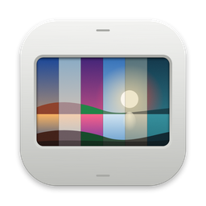
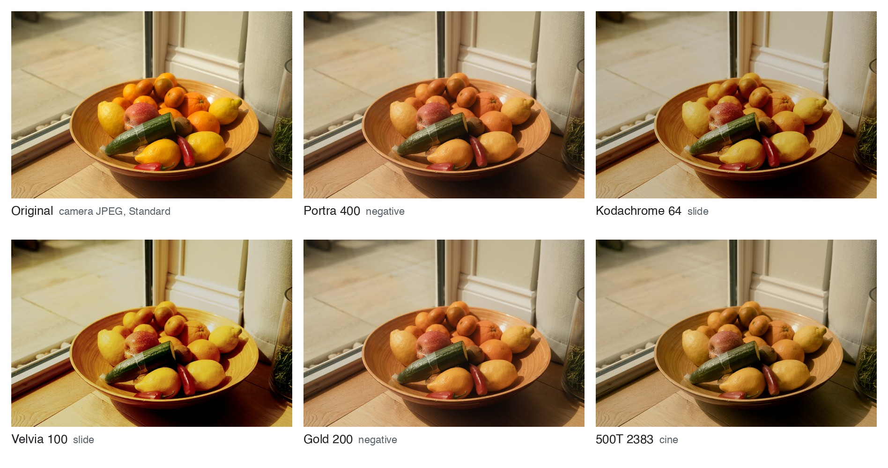
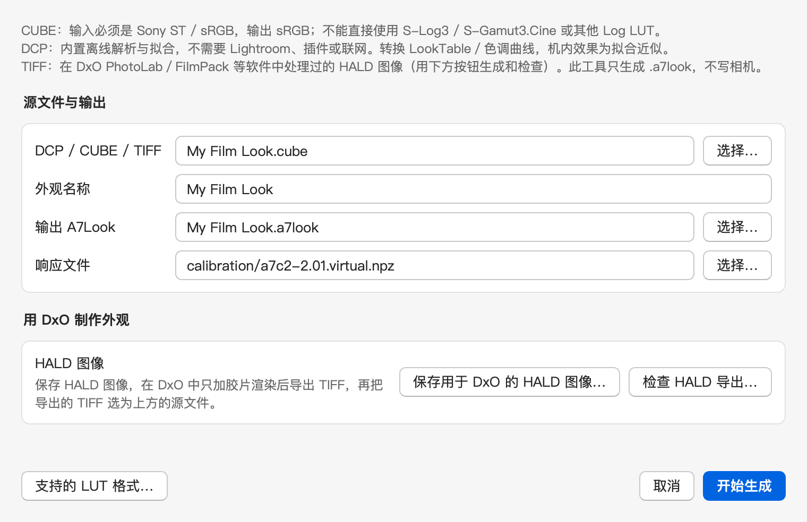
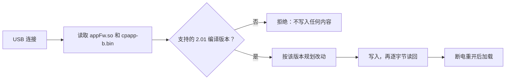

<a id="readme-top"></a>

<div align="center">
  

  <h1>A7C II Tools</h1>

  <p><b>任何 LUT，装进相机。</b></p>

  <p>
    <a href="#用你自己的外观">用你自己的外观</a> •
    <a href="#安装">安装</a> •
    <a href="#首次使用">首次使用</a> •
    <a href="#这个分支改了什么">这个分支改了什么</a> •
    <a href="README.md">English</a>
  </p>
</div>

<div align="center">

[![Latest release][release-shield]][release-url] [![License: PolyForm Noncommercial][license-shield]][license-url] [![Camera: ILCE-7CM2 firmware 2.01][camera-shield]][camera-url] [![macOS: Intel][macos-shield]][install-url]

</div>

把你的 LUT、DCP 配置文件和修图软件里的外观，变成 Sony A7C II 机内的创意外观。英文界面分支，支持 Intel Mac。

A7C II Tools 把照片 LUT、Adobe DCP 配置文件，或修图软件中某个外观的色彩，转换为创意外观，写入相机的六个自定义槽位之一。按下快门前，取景画面就是这个外观，每张 JPEG 都直接带上它。同一个应用还能加入 FL2/FL3、竖屏显示和快门声，并能按需全部恢复。

本项目是 QAQLeonard 的 [A7C II Tools](https://github.com/QAQLeonard/a7c2-fl23-research) 的分支，加入了英文界面、Intel Mac 支持，并在每次写入前核对相机的 2.01 固件编译版本。与上游一样，本分支只允许非商业使用：任何人不得出售它，也不得收费代装。

<picture>
  <source media="(prefers-color-scheme: dark)" srcset="docs/images/readme/looks-dark.jpg">
  
</picture>

<sub>应用转换的五款开放胶片 LUT，套在同一张相机 JPEG 上（A7 IV，标准风格拍摄），即 A7C II 从自定义槽位渲染的效果。外观：[spektrafilm](https://github.com/andreavolpato/spektrafilm)，作者 Andrea Volpato，CC BY-SA 4.0。</sub>

## 用你自己的外观

只改变色彩和影调的外观，都可以放进自定义槽位。转换器在你的电脑上运行，接受三类来源：

| 你手上有 | 怎样放进相机 |
| --- | --- |
| 照片 LUT（`.cube`），输入 Sony ST / sRGB，输出 sRGB | 直接选为源文件。 |
| Adobe 相机配置文件（`.dcp`） | 直接选为源文件，不需要 Lightroom。 |
| 修图软件里的外观，例如 Lightroom 或 Capture One 预设、DxO FilmPack、Dehancer | 保存转换器提供的 HALD 图像，在修图软件中只给它加上外观的色彩，导出 16 位 sRGB TIFF，再选这个 TIFF。已用 DxO FilmPack 和 Dehancer 测试。 |
| 视频或 Log LUT，例如 S-Log3 转 Rec.709 | 先在调色软件中导出 sRGB 输入、sRGB 输出的版本；见 [LUT 格式](docs/zh-CN/lut-formats.md)。 |

1. 在 **自定义创意外观** 页面的 **工具** 中，点 **从 DCP、LUT 或 HALD 图像生成 A7Look** 旁的 **生成…**。选择源文件，起个名字，点 **开始生成**。转换器会把相机的外观表对你的源文件拟合 12 次，保留最接近的一次，所以需要一些时间。
2. 点 **+ 添加操作项**，选择槽位，设为 **写入 A7Look**，选择你的 `.a7look`。**预览…** 会把外观套在你自己用 ST 拍的 JPEG 上，并排显示源文件效果和机内效果。此时还没有写入任何内容。
3. 点 **查看并应用这 1 项更改**，按弹窗操作。断电重开后，这个槽位就是你的外观，其他槽位保持不变。

<picture>
  <source media="(prefers-color-scheme: dark)" srcset="docs/images/readme/convert-zh-dark.png">
  
</picture>

> [!NOTE]
> 相机保存的是对你的外观的拟合近似。拟合较差或未知时，应用会列出该外观并在写入前询问。颗粒、暗角、锐化和局部调整无法放进色彩表，不会被带过去；HALD 检查会拒绝带有这些效果的导出。

## 功能

- **你的外观成为创意外观。** CUBE LUT、DCP 配置文件和修图软件外观都能转换为 `.a7look`，写入自定义 1–6，并使用你取的名字。
- **写入前先预览。** 在你自己的照片上，并排看到源文件效果和机内效果，然后才写入相机。
- **现成的外观。** 6 款内置外观、12 款开放胶片外观，以及 15 对供 Lightroom 使用的 DCP 配置文件。
- **创意外观列表里的 FL2 和 FL3。** 把两款外观加入相机自己的菜单；也可在同一页面移除。
- **竖屏显示。** 竖握相机时，拍摄信息和图标随之转向。
- **电子快门声。** Sony 原生快门声，或从任意音视频中截取的最长 2 秒片段。
- **每次写入前核对固件编译版本。** 应用识别相机的两个程序文件，只写入已知的编译版本，写入后完整读回。
- **恢复原厂功能。** 在工具改动过的位置写回 Sony 原始字节，无需备份或下载固件。

## 拍摄时怎么用

假设你修图时常用三款 LUT：一款暖调人像、一款褪色街拍、一款反转片风格。你在 Mac 上逐一转换，用昨天拍的几张 JPEG 预览，然后一次写入自定义 4、5、6。

应用先写入三个名称，提示断电重开，再写入外观本身并读回。第二次断电重开后，自定义 4–6 就是你的三款外观。

之后在相机上切换，取景画面随之变化，拍之前就能选好外观。每张 JPEG 直接出片，RAW 文件不受影响，仍可按自己的方式冲洗。

## 安装

你需要：固件 2.01 的 Sony A7C II（ILCE-7CM2）、一台 Intel Mac（在 macOS 15 上测试）和一根能传数据的 USB 线。

> [!WARNING]
> 这是非官方的研究软件，与 Sony 无关，也未获 Sony 认可。写入相机可能导致无法开机、反复重启、丢失照片或设置，并可能影响官方更新、保修和维修。完整读回不代表相机一定能正常启动，恢复原厂功能也不保证能救回相机。只在你自己拥有、或已获机主许可的相机上使用，先备份照片，并阅读完整的[风险告知](docs/zh-CN/notices.md#风险告知与使用声明)。

1. 从[最新版本](https://github.com/mplind/a7c2-fl23-research/releases/latest)下载 [`A7C2Tools-macOS-x86_64.dmg`](https://github.com/mplind/a7c2-fl23-research/releases/latest/download/A7C2Tools-macOS-x86_64.dmg)。
2. 打开后把 **A7C II Tools** 拖进“应用程序”。
3. 应用没有开发者签名。首次打开时，在 **系统设置 → 隐私与安全性 → 仍要打开** 中允许。

### Windows 和 Apple Silicon

这个分支只在 Intel Mac 上构建和测试过，因为我只有这一台电脑。各平台代码相同，你可以在要运行它的电脑上自行构建。

1. 安装 64 位 Python 3.11，然后获取代码并安装构建工具：

    ```sh
    git clone https://github.com/mplind/a7c2-fl23-research.git
    cd a7c2-fl23-research
    python -m pip install --no-build-isolation -r desktop-requirements.txt pyinstaller==6.16.0
    ```

2. 从[最新版本](https://github.com/mplind/a7c2-fl23-research/releases/latest)下载 [`A7C2Tools-desktop-assets.zip`](https://github.com/mplind/a7c2-fl23-research/releases/latest/download/A7C2Tools-desktop-assets.zip)，解压到该文件夹。其中包含六款内置外观、胶片外观库、配对 DCP 配置文件和快门声，与 macOS 安装包中的文件相同。
3. 加入所在平台的辅助文件并构建：

    ```sh
    python dev/desktop/prepare_assets.py
    python dev/desktop/build.py --edition public
    ```

4. 安装包位于 `dist/`：Windows 上为 `A7C2Tools-Windows-x64.zip`，Apple Silicon Mac 上为 `A7C2Tools-macOS-arm64.dmg`。在 Windows 上，**连接与驱动** 页面还会为相机安装 USB 驱动。

> [!TIP]
> 如果你在 Windows 或 Apple Silicon 上构建了它，请提交一份[构建报告](https://github.com/mplind/a7c2-fl23-research/issues/new?template=build-report.yml)，写明安装包、操作系统，以及在相机上试过什么，哪怕只是只读的 **测试**。如果需要改动才能构建，也欢迎提交 pull request。你的反馈是这些版本唯一的测试。

## 首次使用

1. 在相机上，把 **MENU → 设置 → USB → USB 连接模式** 设为 **海量存储（MSC）**，连接到 Mac。
2. 在应用中打开 **连接与驱动**，点 **测试**。在弹出的“终端”窗口输入 Mac 登录密码；应用不会读取或保存它。
3. **相机固件编译版本** 一行会显示你的版本，例如“Sony 2.01（机身版本，2025 年 9 月 23 日）”。不写入任何内容。
4. 按[用你自己的外观](#用你自己的外观)写入自己的外观，或打开 **一键安装**，一次写入六款内置外观、FL2/FL3、竖屏显示和快门声。

写入后，弹窗会提示断电重开：拔掉 USB，等存取灯停止闪烁，关机，取下电池至少一分钟，再装回开机。只关机再开机不够。

请阅读每个弹窗；在应用显示“读写已结束”之前，保持相机连接和供电。如果应用报错，请先点 **导出诊断包**，再重试。

<details>
<summary><b>单独使用各项功能</b></summary>

这些页面的每次写入都会读回，然后弹窗给出下一步：通常是断电重开，以及在相机上要检查什么。

- **一键安装：** 勾选需要的功能，点 **一键安装…** 开始。弹窗提示时，断电重开、接回，再点 **继续安装** 完成。
- **FL2 / FL3：** **启用** 把 FL2 和 FL3 加入创意外观列表。**移除** 把它们从列表拿掉，自定义外观照常可用。移除前请在相机上选 ST。
- **自定义创意外观：** 对每个要改的槽位点 **从胶片外观库添加…** 或 **+ 添加操作项**，再点 **查看并应用这 N 项更改** 写入。名称有变化的槽位分两步写：先写名称，断电重开后点 **继续槽位更改** 写入外观本身。
- **竖屏显示：** 用 **开启** 或 **停用** 切换。断电重开后，横握和竖握分别检查 Fn 菜单。竖屏创意外观选择页的外框仍偏粗，橙色指针朝向尚未修正。
- **电子快门声：** **开启** 后，使用电子快门时播放 Sony 原生声音（需打开“音频信号”）。要用自己的声音：选择文件，点 **转换**，可先在相机上 **试听**，再点 **保存到相机…** 保存。
- **恢复原厂功能：** **恢复…** 写回 Sony 原始字节，并把自定义 1–6 恢复为 ST。断电重开后点 **核对**；只有核对通过，恢复才算完成。

</details>

<details>
<summary><b>出问题时</b></summary>

| 现象 | 怎么做 |
| --- | --- |
| 相机显示“请检查连接的设备” | 任务进行中属正常现象，以应用的提示为准。 |
| 三次尝试后相机仍未进入服务模式 | 没有写入任何内容。断电重开、接回后重试。 |
| 槽位更改在写完名称后停下 | 断电重开、接回，再点 **继续槽位更改**（一键安装页为 **继续安装**）。 |
| 版本一行显示固件编译版本不受支持 | 所有写入按钮已停用，没有写入任何内容。应用只支持 Sony 公开的 2.01 更新和[这个分支改了什么](#这个分支改了什么)中的第二种 2.01 编译版本。 |
| 任何操作报告结果未知 | 不要重试写入。点 **导出诊断包** 并保留诊断包。 |

</details>

## 这个分支改了什么

| 改动 | 说明 |
| --- | --- |
| 英文界面 | 按钮、弹窗、日志和终端信息，逐条按代码的实际作用核对。在“界面语言”中仍可切回中文。 |
| Intel Mac | 可在 x86_64 macOS 上构建和运行。原项目只构建 Apple Silicon 版本。 |
| 固件编译版本核对 | 读取 `appFw.so` 和 `cpapp-b.bin`，排除工具所属区域后，与支持的版本比对 SHA-256，然后才写入。 |
| 第二种 2.01 编译版本 | 支持 CP 构建日期为 2025 年 9 月 23 日的 2.01 编译版本。它出现在一台版本界面显示 2.01、但程序与 Sony 公开更新不同的机身上，Sony 的更新程序不会重新安装它。 |
| 单次连接继续 | 继续暂停的槽位更改时，在同一次服务连接中核对重开并写入外观。 |
| 提示一致 | 每次写入后，状态栏、终端和弹窗给出同样的下一步。 |

[更新日志](docs/zh-CN/changelog.md)记录了每项改动。

## 一次写入的过程



## 目前的测试

2026 年 10 月 30 日和 31 日，在一台运行第二种 2.01 编译版本的 A7C II 上，用 Intel Mac 测试：

| 功能 | 结果 |
| --- | --- |
| 版本核对（只读指纹和应用内“测试”） | 识别出版本，没有写入 |
| 由 CUBE LUT 和 HALD 导出转换的六款外观，以及之后更换的一个槽位 | 已写入、读回，断电重开后可用 |
| FL2 / FL3 | 已写入、读回，断电重开后可用 |
| 竖屏显示 | 已写入、读回，横握和竖握均已检查 |
| 电子快门声 | 未在这台相机上测试 |
| 恢复原厂功能，以及把槽位恢复为 ST | 未用本分支在这台相机上测试 |
| Windows 和 Apple Silicon 版本 | 本分支未构建、未测试 |

离线测试覆盖了两种 2.01 编译版本的真实程序文件。字节读回和离线测试不能证明每台相机都表现一致；目前只有一台相机运行过本分支。

## 开发

用 64 位 Python 3.11 从源码运行应用，并在不连接相机的情况下运行测试：

```sh
python -m pip install --no-build-isolation -r desktop-requirements.txt pytest==8.3.5
python -m pytest dev/desktop dev/shutter_sound/tests dev/vertical -q
```

打包、代码结构和提交检查（`git config core.hooksPath dev/git-hooks`）见[开发指南](docs/zh-CN/development.md)。修改会写入相机的代码前，请先阅读 [AGENTS.md](AGENTS.md)。

## 致谢

A7C II Tools 由 [QAQLeonard](https://github.com/QAQLeonard) 和原项目的贡献者完成，这个分支在其基础上补充。如想支持原作者，请看[原项目 README](https://github.com/QAQLeonard/a7c2-fl23-research#readme) 中的赞助部分。

原项目参考并建立在 [lzh2016zzz/a7cr-fl23-research](https://github.com/lzh2016zzz/a7cr-fl23-research)、[Hearts-Ace/sony-a7r5-custom-firmware](https://github.com/Hearts-Ace/sony-a7r5-custom-firmware)、[MDHan/a7c2-fl23-macos](https://github.com/MDHan/a7c2-fl23-macos)、[ma1co/Sony-PMCA-RE](https://github.com/ma1co/Sony-PMCA-RE)、[ma1co/fwtool.py](https://github.com/ma1co/fwtool.py) 和 [YuuLuo/a7c2-service-preload](https://github.com/YuuLuo/a7c2-service-preload) 之上。富士和理光参考 DCP 归功于小红书的门萨特里顿和爸总林先森，开放胶片外观来自 Andrea Volpato 的 [spektrafilm](https://github.com/andreavolpato/spektrafilm)。每款内置外观的来源和许可见[声明](docs/zh-CN/notices.md)。

这是独立项目，与 Sony、Fujifilm、Ricoh、Kodak、Adobe、Capture One、DxO 或 Dehancer 无关。外观名称只描述风格，不代表授权或颜色完全一致。

## 相关项目

其他机型：[lzh2016zzz/a7cr-fl23-research](https://github.com/lzh2016zzz/a7cr-fl23-research)（A7CR）、[injectiver/a7cr-creative-look-tools](https://github.com/injectiver/a7cr-creative-look-tools)（A7CR）、[Hearts-Ace/sony-a7r5-custom-firmware](https://github.com/Hearts-Ace/sony-a7r5-custom-firmware)（A7R V）、[DavidBuchanan314/ILCE-7M4-RE](https://github.com/DavidBuchanan314/ILCE-7M4-RE)（A7 IV）和 [751K/sony-a7m5-looks](https://github.com/751K/sony-a7m5-looks)（A7 V 外观的 Lightroom 配置文件）。它们是独立项目，范围和风险各不相同。

## 许可

与上游一样采用 [PolyForm Noncommercial 1.0.0](LICENSE)。你可以出于任何非商业目的使用、修改和分享本分支；禁止一切商用牟利，包括收费代刷、收费代装、转售和付费捆绑。

上游在 2026 年 10 月 25 日之前的版本保留其 [MIT 条款](docs/licenses/project-legacy-MIT.txt)。内置外观、DCP 配置文件和第三方组件保留各自的许可，必需声明见[声明](docs/zh-CN/notices.md)。

[release-shield]: https://img.shields.io/github/v/release/mplind/a7c2-fl23-research?style=flat-square&color=c4732b&label=release
[release-url]: https://github.com/mplind/a7c2-fl23-research/releases/latest
[license-shield]: https://img.shields.io/badge/license-PolyForm%20Noncommercial-c4732b?style=flat-square
[license-url]: LICENSE
[camera-shield]: https://img.shields.io/badge/camera-ILCE--7CM2%20firmware%202.01-c4732b?style=flat-square
[camera-url]: #安装
[macos-shield]: https://img.shields.io/badge/macOS-Intel-c4732b?style=flat-square
[install-url]: #安装
